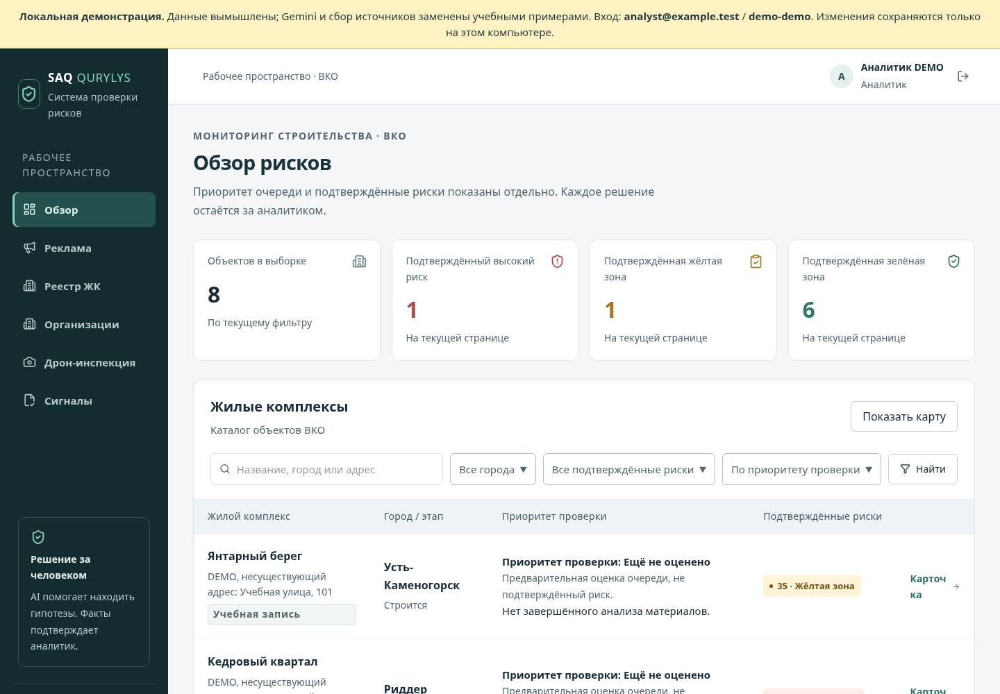

<div align="center">

# SAQ QURYLYS

**Мониторинг рекламы строящегося жилья и рабочее место аналитика**

ALEteam · Code Masters Hackathon 8.0 · Восточно-Казахстанская область

[](https://github.com/arturk0-0/3a-saq-qurylys/actions/workflows/ci.yml)


[Запустить локально](#быстрый-запуск) · [Проверить за 5 минут](docs/judge-runbook.md) · [Документация](docs/README.md)

</div>

SAQ QURYLYS собирает рекламу жилья из открытых источников, помогает выделить
материалы для проверки и связывает их с жилыми комплексами. Аналитик видит
оригиналы, документы, историю решений и сведения об участниках строительства
в одном рабочем пространстве.

**Реклама → автоматический приоритет → проверка аналитиком → сигнал и PDF.**

ИИ предлагает гипотезы и цитаты. Подтверждённая оценка риска меняется только
после решения человека; высокий приоритет сам по себе не означает нарушение.



*Снимок настоящего интерфейса в локальном режиме. Названия и данные на нём учебные.*

## Что умеет приложение

| Возможность | Что получает аналитик |
| --- | --- |
| **Единая реклама** | Все материалы, поиск и фильтры, оригиналы публикаций, повторяющиеся объявления в одной карточке. |
| **Сбор по расписанию** | Выбранные публичные Telegram-каналы и Instagram-реклама из Meta Ad Library через SearchAPI; настраиваемые запросы и интервалы. |
| **Одна проверка** | Автоматические гипотезы, выбор ЖК, цитаты и решения по признакам на одной странице с одним сохранением. |
| **Карточка ЖК** | Документы, подтверждённые R1–R6, рекламный след, юридический застройщик и уполномоченная компания со ссылками на источники. |
| **Сигналы и отчётность** | Передача на проверку, подтверждение или возврат, история и PDF по сохранённому снимку данных. |
| **Карта и дрон** | Карта с условными объёмными зданиями по известным координатам; отдельный фотоосмотр по визуальному чек-листу. |

Приоритет проверки и подтверждённый риск — разные показатели.
[Формула и контрольные примеры](docs/risk-rules.md).

## Быстрый запуск

Нужен **Docker Desktop или Docker Engine с Compose v2**. Для команды `git clone`
нужен Git; вместо неё можно скачать **Code → Download ZIP** и распаковать архив.
В Windows Docker Desktop должен работать в режиме Linux containers.

```bash
git clone https://github.com/arturk0-0/3a-saq-qurylys.git
cd 3a-saq-qurylys
docker compose -f compose.demo.yaml up --build --wait --wait-timeout 180
```

Откройте **http://localhost:5173** и войдите:

| Почта | Пароль |
| --- | --- |
| `analyst@example.test` | `demo-demo` |

**Ключи API, `.env` и облачные аккаунты для этого запуска не нужны.**
Первая сборка скачивает зависимости. После сборки локальная демонстрация работает
без внешних API; изменения и файлы сохраняются в отдельном Docker volume.

Внутри — 8 учебных ЖК, 12 объявлений и готовые примеры с оценками **35 / 70 / 10**.
Можно проверить интерфейс, автоматическую очередь, решения аналитика, историю,
загрузку файлов, сигналы и настоящий PDF. В этом режиме анализ текста и сбор
заменены учебными адаптерами; изображения сохраняются без распознавания.
Настоящие Gemini и внешние источники подключаются в облачной конфигурации.

**Далее:** [сценарий проверки за 5 минут](docs/judge-runbook.md) ·
[подробный локальный запуск](docs/local-demo.md) · [инструкция для Windows](docs/windows-start.md).

Остановка с сохранением данных:

```bash
docker compose -f compose.demo.yaml down
```

Если что-то не открылось: проверьте `docker compose -f compose.demo.yaml ps`
и [раздел помощи](docs/local-demo.md#если-не-запускается). Команда `down -v`
удаляет локальные данные; для обычной остановки она не нужна.

## Как устроен проект

**React + TypeScript + Vite** — интерфейс. **FastAPI + Pydantic** — API и проверка
данных. **Firebase Auth, Firestore и Storage** — облачный доступ, данные и файлы.
**Gemini** вызывается сервером. **Leaflet / OpenStreetMap** — карта,
**WeasyPrint** — PDF. [Подробнее об архитектуре](docs/architecture.md).

```text
frontend/       Интерфейс приложения и его тесты
backend/        API, анализ, скоринг, хранение и тесты
data/seed/     Учебный набор данных
scripts/        Локальные проверки
deploy/        Публикация в Google Cloud / Firebase
docs/          Инструкции, архитектура и результаты проверок
```

## Проверки и собственная конфигурация

GitHub Actions проверяет backend, frontend, Firestore SDK, обычный Compose и
локальную демонстрацию с перезапуском. В проверенной версии: **558 backend-тестов,
133 frontend-теста и 19 интеграционных проверок Firestore SDK**.
[Результаты и границы проверки](docs/judge-release-report.md).

[Команды разработки и тестов](docs/development.md) ·
[Firebase и собственный экземпляр](docs/firebase-setup.md) ·
[Публикация](docs/cloud-deployment.md).

## Сайт и границы возможностей

Облачный сайт: **https://saq-qurylys.web.app**. Для него команда выдаёт отдельный
доступ аналитика; локальный учебный логин там не работает. `main` содержит
последнюю проверенную реализацию; её публикация на сайте — отдельный этап.

Сбор охватывает настроенные публичные источники и зависит от их доступности.
Внешняя ссылка на видео не означает, что видео проанализировано. Карта показывает
условные здания, а не фактическую этажность или готовность. Фотоосмотр дрона
помогает изучить видимые признаки и не устанавливает соблюдение всех строительных норм.

[Документация проекта](docs/README.md) · [План](docs/DEVELOPMENT_PLAN.md) · [История разработки](docs/WORK_LOG.md)
