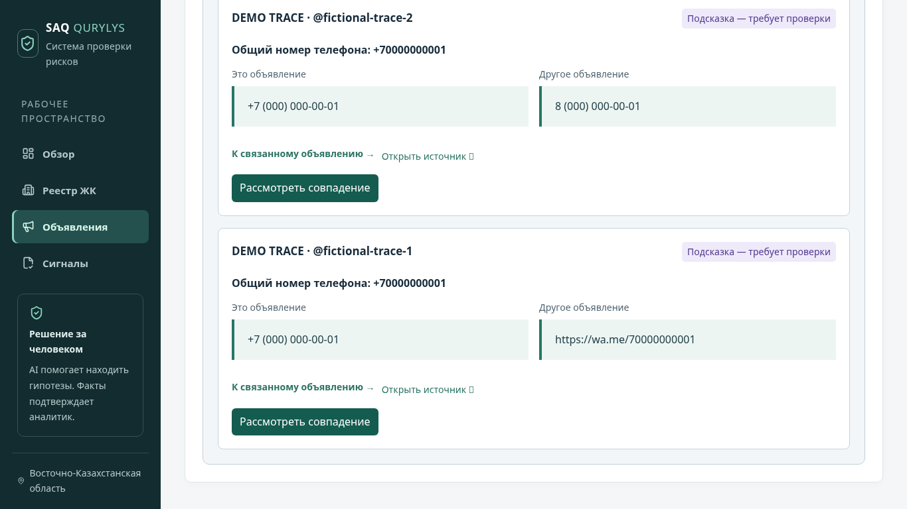

# Рекламный след · LINK-01–05

Реализация P1: [PR #7](https://github.com/arturk0-0/3a-saq-qurylys/pull/7),
`feat/LINK-advertising-trace`, поверх дизайна PR #6.
Это отдельный список связанных объявлений, не новый фактор R1–R6.
После слияния требуется публикация backend и frontend; наличие ветки не означает,
что работающий сайт уже обновлён. Новые API/коллекция описаны ниже для командного
review вместе с frontend/backend реализацией. Существующие контракты не меняются.

## Что делает модуль

Из оригинального текста извлекаются:

- Телефоны: 11 цифр с +7, 7 или 8 приводятся к +7. Местные короткие номера,
  БИН и иностранные форматы не дополняются догадками. Нормализация не проверяет,
  существует ли номер и кому он принадлежит.
- WhatsApp `wa.me/<номер>` и `/send?phone=...`: связываются с тем же номером,
  в том числе записанным в другом объявлении обычным текстом. Коды вида
  `wa.me/message/...` не раскрываются и не угадываются.
- Сайты: регистр, начальный www и IDNA нормализуются, но поддомены не объединяются
  в предполагаемый домен организации. Сайт публикации из `sourceUrl` не является
  признаком рекламодателя; общие домены Instagram, WhatsApp и других известных
  площадок в тексте также исключаются.
- Названия: точные нормализованные слова имени/aliases выбранного ЖК; используется
  существующий нормализатор AI-05. Совпадение только названия помечается слабой
  подсказкой. Транслитерации, смешение похожих букв разных алфавитов и нечёткий
  поиск не выполняются.

Каждое совпадение содержит точные фрагменты двух исходных текстов и диапазоны
Python Unicode code points `[start, end)`, **не** JS UTF-16 offsets. Версии текстов,
SHA-256 и `ad-trace-v1` фиксируются в снимке. URL не загружаются, внешние площадки
не опрашиваются. Gemini и сравнение изображений для этой функции не используются.



## Работа аналитика

1. Откройте объявление → **Рекламный след**. Запрос выполняется только после
   открытия панели; показанные подсказки ещё не являются решением человека.
2. Сравните фрагменты «Это объявление» / «Другое объявление»; откройте оригиналы.
   «К связанному объявлению» ведёт на отдельную карточку конкретной публикации,
   независимо от пагинации общего списка.
3. Нажмите **Рассмотреть совпадение**, выберите подтверждение/отклонение,
   введите обоснование и явно сохраните решение. Сервер сначала сохраняет
   proposed-снимок, затем отдельно применяет решение аналитика.
4. При ошибке второго запроса proposed-снимок остаётся доступным. Повтор его
   создания идемпотентен; несохранённые заметки остаются в форме. При конфликте
   обновите совпадения и проверьте актуальное решение перед повтором.
5. Подтверждение означает только проверенное совпадение указанных признаков.
   Общий владелец/незаконность не устанавливаются, баллы и сигналы не меняются.

Обновлённые тексты/версии или изменившиеся причины требуют нового просмотра.
Подтверждение устаревшего сохранённого снимка запрещено. Старые снимки и аудит
не перезаписываются; текущий список показывает совпадения актуальных источников.
Исторические снимки остаются в закрытой коллекции и журнале, отдельного просмотра
архива связей в этом этапе нет.

## Ограничения выборки

Проверяются до 199 других объявлений того же DEMO/non-DEMO scope из начала
каталога по ID, выводятся до 20 подходящих пар. На текст — до 100 фрагментов;
неполная пара не предлагается к подтверждению. Флаги `scanLimited`,
`resultsLimited`, `identifiersLimited` показываются явно. Это не полный поиск
в большом реестре и не поиск по закрытым аккаунтам. Отсутствие совпадения в
выборке не доказывает отсутствия связи. Приватные аккаунты/скриншоты и
принадлежность сайтов/телефонов автоматически не проверяются.

## Дополнение API и данных

Все пути ниже начинаются с `/api/v1`, требуют прежний Firebase ID token и роль
analyst/admin. Ответы имеют `Cache-Control: no-store`, старые rules deny-by-default
действуют и на новую коллекцию. Новых секретов, IAM grants и составных индексов
для этих запросов не требуется; живое развёртывание здесь не проверялось.

- `GET /advertisements/{id}/trace`: read-only, возвращает `items`, `scannedCount`,
  флаги ограничений и `normalizerVersion`. Элемент: `id` снимка, `snapshot`,
  `otherAdvertisement` (id, complexId, platform, account, sourceUrl, version),
  `saved` (сохранённая связь или null).
- `POST /advertisements/{id}/trace`: `otherAdvertisementId`, `expectedVersion`,
  `expectedOtherVersion`, `expectedSnapshotId` (SHA-256 из preview). Повторно
  проверяет оба объявления/ЖК и scope в транзакции, пересчитывает совпадение;
  несовпадение версий/снимка даёт 409, отсутствие признака — `TRACE_NO_MATCH`.
  Возвращает `AdLink`; идентичный повтор возвращает прежнюю запись без нового аудита.
- `POST /ad-links/{id}/decision`: `decision: confirmed | rejected`, `notes`
  (непустое, до 2000), `expectedVersion`. Разрешён только переход из proposed.
  Изменённые оригиналы/алгоритм дают `TRACE_STALE` (409). Нет автоматических
  повторов, пересмотра существующего решения или подтверждения факторов риска.

`adLinks/{id}`: поля снимка `leftId/rightId`, `leftVersion/rightVersion`,
`leftTextSha256/rightTextSha256`, `demo`, `matches`, `nameOnly`,
`normalizerVersion`; поля решения `status`, `createdBy/createdAt`,
`reviewer/reviewedAt`, `notes`, `version`. В matches сохраняются `kind`,
`normalized`, `left/right` фрагменты с `quote/start/end/origin`.
ID — SHA-256 канонического полного снимка. В `auditLogs` атомарно записываются
`adLink.propose` и `adLink.review` для каждого затронутого ЖК без дублирования
общего ЖК. Причина решения — в закрытой записи и review-аудите, не в логах.

## DEMO без внешних сервисов

Из корня с установленным backend:

```bash
cd backend
.venv/bin/python -m app.cli.trace
```

Команда только печатает результат для встроенных вымышленных текстов, не читает
.env, не подключается к Firebase/Gemini и ничего не импортирует в живую базу.
Она показывает одну пару (+7/WhatsApp), слабый общий бренд и независимый третий
контакт. Это детерминированный matcher, не результат AI.

Для приёмки UI на опубликованной версии вручную добавьте два объявления к DEMO
ЖК с разными вымышленными аккаунтами и ссылками `https://demo.invalid/trace/one`
и `/trace/two`. Тексты:

```text
DEMO — вымышленное объявление. Контакт +7 (000) 000-00-01.
```

```text
DEMO — другой вымышленный аккаунт. WhatsApp: https://wa.me/70000000001
```

Префикс 000 намеренно учебный, номера не предназначены для связи. Откройте
Рекламный след, проверьте пару, подтвердите совпадение с причиной, перезагрузите
карточку и сверьте сохранение решения. Баллы R1–R6 должны остаться прежними.

## Фактические проверки

- 317 backend unit tests, включая нормализацию, точные RU/KZ/Unicode цитаты,
  подмену scope/снимков/версий, отсутствие мутаций факторов, гонки и API auth.
- 11 настоящих SDK integration tests в отдельном локальном Firestore emulator:
  новый round trip сохраняет proposed → confirmed, аудит, отдельную версию
  снимка, stale block и запрет прямых клиентских read/write новой коллекции.
- 64 Vitest, TypeScript/Vite build. Сохраняется известное предупреждение JS chunk
  >500 kB. Ruff check/format и diff-check пройдены.
- 16 Chromium-групп с явными локальными тестовыми адаптерами: старый путь до
  настоящего PDF и новый LINK-сценарий, подтверждение/отклонение, reload,
  переход к конкретному объявлению, сохранение заметок при конфликте,
  1366/375/320 без горизонтального переполнения. Артефакты:
  `/tmp/saq-trace-verified/`, 658 локальных browser requests.

SDK runner не проверяет production IAM/индексы или Gemini. Первый проход нового
SDK-теста связей прошёл, но прежний тест конкурентной AI-квоты получил допустимый
409 вместо ожидавшегося 429. Тест уточнён: явный повтор с тем же idempotency key
после завершения конкуренции обязан дать 429 без второго provider call. Итоговый
полный emulator suite — 11 passed. В браузерном runner устранена гонка удаления
перехватчиков: перед их снятием ожидается завершение текущих сетевых запросов;
утверждения об отсутствии внешних обращений/ошибок сохранены.

Независимое review новых контрактов и ручная приёмка опубликованного модуля
остаются следующими шагами. Дизайн PR #6 должен быть слит первым. После этого base PR #7 необходимо
переключить с `feat/frontend-readable-workflow` на `main`. Затем модуль
требует обычной сборки/publish API и Hosting по `cloud-deployment.md`; правила,
seed и существующие данные автоматически не перезаписываются.
