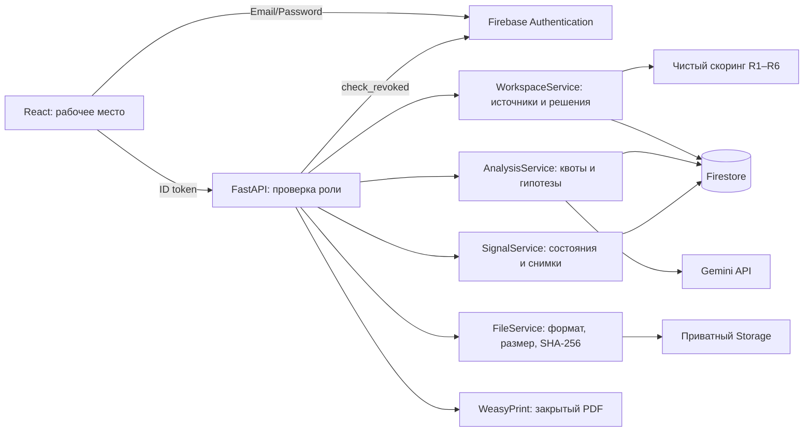

# Архитектура

React/TypeScript/Vite + Tailwind/shadcn Button → FastAPI/Pydantic →
Firebase Auth, Firestore, приватный Firebase Storage и серверный Gemini.
PDF формируется WeasyPrint из сохранённого снимка сигнала.

Слои: api — HTTP/auth/валидация; services — правила и orchestration;
repositories — SDK persistence; models/schemas — camelCase контракты.
Firestore transactions читают все документы до записи; optimistic version
предотвращает потерю параллельного решения. Audit и бизнес-запись атомарны.
Предыдущие версии сигнала сохраняются в signalRevisions.

Клиенты не имеют прямого доступа к Firestore/Storage по rules. Admin SDK
обходит rules, поэтому сервер отдельно проверяет token, роль и DEMO scope.
Развёртывание rules не заменяет IAM: bucket не должен иметь публичных grants.
В приложении нет второго хранилища или режима поддельной авторизации.
MemoryStore/HTTP MockTransport используются исключительно в тестах.

Локально Vite проксирует /api; публичное развёртывание этим Compose не делается.
Сервисы слушают loopback хоста. В cloud onboarding нет поддержанного browser
предпросмотра локального порта; ссылки localhost не ведут из браузера пользователя
в облачную машину. Для демонстрации нужен локальный запуск или отдельный deployment.

Ограничения текущей версии: реестр до 500 отобранных записей, нет full-text индекса;
нет фоновых AI workers, карты и автоматического поиска совпадений ЖК/рекламы.
Firestore и Storage не образуют общую транзакцию, очистка несвязанных файлов ручная.
Live-доступы Firebase/Gemini и проверка на втором компьютере остаются отдельным gate.
