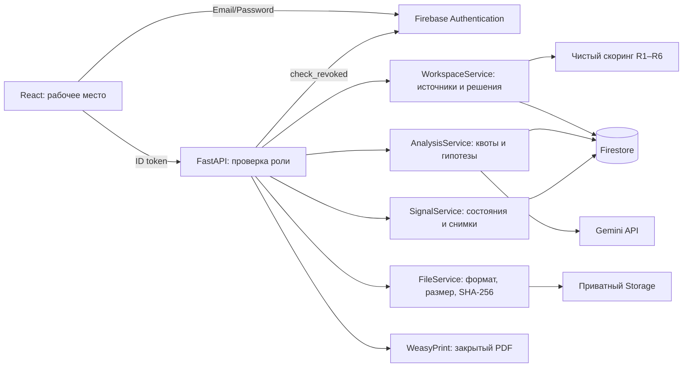

# Архитектура

React/TypeScript/Vite + Tailwind/shadcn Button → FastAPI/Pydantic →
Firebase Auth, Firestore, приватный Firebase Storage и серверный Gemini.
PDF формируется WeasyPrint из сохранённого снимка сигнала.

Слои: api — HTTP/auth/валидация; services — правила и orchestration;
repositories — SDK persistence; models/schemas — camelCase контракты.
Firestore transactions читают все документы до записи; optimistic version
предотвращает потерю параллельного решения. Audit и бизнес-запись атомарны.
Предыдущие версии сигнала сохраняются в signalRevisions.

Клиенты не имеют прямого доступа к Firestore/Storage по rules. Admin SDK
обходит rules, поэтому сервер отдельно проверяет token, роль и DEMO scope.
Развёртывание rules не заменяет IAM: bucket не должен иметь публичных grants.
В приложении нет второго хранилища или режима поддельной авторизации.
MemoryStore/HTTP MockTransport используются исключительно в тестах.

Локально Vite проксирует /api; публичное развёртывание этим Compose не делается.
Сервисы слушают loopback хоста. В cloud onboarding нет поддержанного browser
предпросмотра локального порта; ссылки localhost не ведут из браузера пользователя
в облачную машину. Для демонстрации нужен локальный запуск или отдельный deployment.

Есть карта Leaflet/OpenStreetMap по сохранённым координатам DEMO-объектов,
read-only кандидаты ЖК по названиям/aliases из AI-результата и ссылки на открытые
реестры. Это не интеграция с государственными базами и не автоматическая
привязка объявления или доказательство общей принадлежности рекламных аккаунтов.

Ограничения: реестр до 500 отобранных записей, нет full-text индекса.
В MON-ветке добавлен отдельный CLI worker, но облачное расписание не включено.
[«Рекламный след»](advertising-trace.md) сравнивает текстовые
идентификаторы в ограниченной выборке, сохраняет human-reviewed связи в `adLinks`
и аудит транзакционно. Скоринг, юридические доказательства и AI не изменяются.
Сравнение изображений и проверка общности владельца не реализованы.
Firestore и Storage не образуют общую транзакцию. При достоверном отказе загрузки
по версии до любых записей удаляется уникальный объект этого запроса;
при неизвестном исходе commit файл сохраняется, дальнейшая очистка ручная.
По сообщению владельца работали облачные вход/DEMO/Gemini и ручной R2 10→35;
полная облачная матрица, второй компьютер и независимое review остаются gates.

QA использует MemoryStore/MockTransport, отдельный браузерный runner и opt-in
Firestore emulator для настоящего SDK. Это изолированные инструменты тестирования;
обычный запуск и production не зависят от эмулятора. Его успешный прогон не
проверяет production composite indexes, IAM или реальные внешние сервисы.

## MON: отдельная очередь и управляемый worker

`/monitoring` → auth API → MonitoringService → фиксированные HTTPS RSS/t.me
адаптеры → monitorItems (реальные наводки). Отдельный ADC CLI/Cloud Run Job
использует тот же сервис. Браузер только читает/запускает явные действия;
его polling не является серверным расписанием.

Транзакция резервирует fetch quota/lease → ограниченный HTTP вне транзакции →
CAS-запись находок → завершение запуска. Опционально не более одного AI/запуск
с общими usageLimits, моделью/prompt/hash и неподтверждённым результатом.
Поздний worker не перезаписывает новую lease; повтор текста не стирает review.
Реальная очередь работает отдельно от DEMO-only реестра. Только явная real→real
привязка переносит публикацию/proposed-гипотезы в прежний поток факторов/сигнала.
R1–R6 не меняются сборщиком или LLM.

Instagram Ads KZ имеет внешний prerequisite; стандартный Ads Archive/поисковые
посты не выдаются за полный таргет. Архитектура очереди пригодна для будущего
поставщика, но не содержит фиктивного Instagram-адаптера.
[Контракты/восстановление/лимиты](monitoring.md),
[фактическая проверка Instagram](instagram-feasibility.md).
